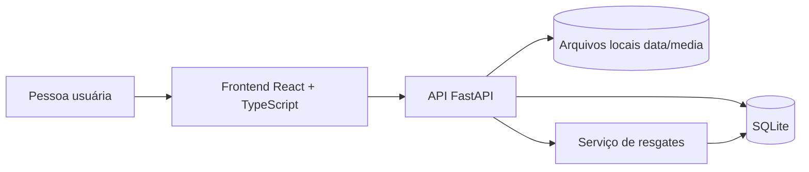

# Echo

**Memória criativa.** Um espaço para capturar, organizar e reencontrar fragmentos das suas ideias.

## 🖇️ Sobre o projeto

O **Echo** é um sistema de memória criativa pessoal que parte de uma ideia: nem todo pensamento precisa nascer pronto para merecer ser guardado. Nem toda ideia esquecida perdeu potencial.

Rascunhos, frases, referências visuais e registros sonoros costumam ficar espalhados em bloco de notas, aplicativos e arquivos. Com o tempo, parte desse material se perde. O Echo reúne esses fragmentos em um espaço no qual podem ser registrados, organizados por temas, marcados como favoritos e redescobertos posteriormente.

A proposta é **ampliar a capacidade de lembrar e desenvolver ideias**. O sistema tem como objetivo apoiar a memória e a organização do material que o usuário produz.

> **Guarde o fragmento. Faça conexões. Volte a ele quando quiser.**

A intenção é que a tecnologia funcione como uma extensão da memória: um lugar de apoio para que a pessoa possa retomar seu próprio material e decidir o que fazer com ele posteriormente.

## ⭐ Preview

https://github.com/user-attachments/assets/03652c4e-f274-4330-9b6b-34f2873ab1da


## ✨ Funcionalidades

### Capturas

O Echo permite registrar diferentes tipos de fragmentos:

- **Texto:** anotações, frases, ideias em desenvolvimento e pequenos registros.
- **Imagem:** envio de arquivos visuais associados a uma captura.
- **Áudio:** envio de arquivos sonoros, com reprodução do áudio salvo na visualização da captura.

Cada captura pode ter título, conteúdo ou contexto e um ou mais temas associados. Os arquivos de imagem e áudio são enviados para o backend e vinculados à captura correspondente.

### Temas e conexões

Os temas ajudam a criar caminhos entre fragmentos que pertencem a um mesmo universo de interesse. Uma captura pode estar associada a **vários temas ao mesmo tempo**.

Na área de temas é possível:

- Criar temas;
- Renomear temas existentes;
- Excluir temas;
- Filtrar capturas por tema;
- Abrir um tema a partir dos atalhos do painel lateral.

Excluir um tema remove suas associações, mas preserva as capturas relacionadas.

### Favoritas

Capturas podem ser marcadas ou desmarcadas como favoritas. Essa escolha é persistida no banco de dados e alimenta uma seção própria para reunir os fragmentos que merecem permanecer por perto.

### Resgates

A área de Resgates ajuda a reencontrar capturas que não recebem atenção há algum tempo. Essa seleção é feita no backend por uma pontuação determinística baseada no tempo sem revisita e em temas de foco atual.

Parâmetros atuais do algoritmo:

- Capturas ficam elegíveis após **7 dias** sem atenção;
- A pontuação base considera os dias sem atenção, limitada a **60 pontos**;
- Capturas nunca revisitadas recebem **14 pontos adicionais**;
- Uma correspondência com um tema em foco acrescenta **20 pontos**;
- Uma captura apresentada em um resgate entra em um período de intervalo de **7 dias** antes de poder aparecer novamente.

A lista é ordenada pela pontuação, com critérios de desempate para priorizar capturas há mais tempo sem atenção. O limite da API pode variar de 1 a 20 resultados.

### Busca e navegação

A interface oferece busca por título, conteúdo, temas e tipo de captura, além de filtros por formato. O ambiente de trabalho é dividido em cinco seções:

| Seção | Rota |
| --- | --- |
| Visão geral | `/app` |
| Capturas | `/app/captures` |
| Favoritas | `/app/favorites` |
| Temas | `/app/themes` |
| Resgates | `/app/rescues` |

A homepage (`/`) apresenta o Echo e direciona para as seções do ambiente de trabalho. A navegação interna utiliza React Router.

## 🧭 Como o sistema está organizado

O projeto é dividido em duas partes principais: uma aplicação frontend, responsável pela experiência de uso, e uma API backend, responsável pela persistência e pelas regras de negócio.



### Frontend

O frontend é uma Single Page Application construída com React, TypeScript e Vite. Ele contém a homepage, o workbench, os componentes de captura, os modais, os filtros e os hooks responsáveis por buscar e atualizar os dados da API.

A comunicação HTTP fica centralizada em `frontend/src/services/api.ts`. A transformação das respostas da API para o modelo utilizado pelos componentes fica em `frontend/src/utils/captureAdapter.ts`.

### Backend

O backend utiliza FastAPI para expor os endpoints, SQLAlchemy para mapear os dados e SQLite como banco padrão. As regras de seleção e pontuação dos resgates ficam isoladas em `app/services/rescue.py`.

Arquivos de imagem e áudio não são armazenados como conteúdo binário dentro do SQLite: o banco guarda seus metadados, enquanto os arquivos ficam no diretório local `data/media/`.

## 🧰 Tecnologias

| Camada | Tecnologias |
| --- | --- |
| Interface | React 19, TypeScript 6, Vite 8 |
| Rotas | React Router |
| Ícones | Lucide React |
| Estilos | CSS |
| API | Python, FastAPI, Pydantic |
| Persistência | SQLAlchemy, SQLite |
| Arquivos de mídia | Pillow (validação de imagens), Mutagen (validação de áudio) |
| Servidor ASGI | Uvicorn |
| Testes backend | Pytest |
| Qualidade frontend | ESLint, TypeScript (`tsc -b`) |

## 📁 Estrutura do repositório

```text
Echo/
├── app/
│   ├── database/
│   │   ├── database.py
│   │   └── init_db.py
│   ├── models/
│   │   ├── association.py
│   │   ├── capture.py
│   │   ├── capture_asset.py
│   │   ├── rescue_event.py
│   │   └── theme.py
│   ├── routes/
│   │   ├── assets.py
│   │   ├── captures.py
│   │   ├── rescues.py
│   │   └── themes.py
│   ├── schemas/
│   │   ├── capture.py
│   │   ├── capture_asset.py
│   │   ├── rescue_event.py
│   │   └── theme.py
│   ├── services/
│   │   └── rescue.py
│   └── main.py
├── data/                     # Criado localmente; ignorado pelo Git
│   ├── eco.db                # Banco SQLite padrão
│   └── media/                # Imagens e áudios enviados
├── frontend/
│   ├── public/
│   │   ├── echo-favicon.png
│   │   └── videos/
│   │       └── homepage-loop.mp4
│   ├── src/
│   │   ├── assets/
│   │   ├── components/
│   │   ├── data/
│   │   ├── hooks/
│   │   ├── pages/
│   │   ├── services/
│   │   ├── styles/
│   │   ├── types/
│   │   ├── utils/
│   │   ├── App.tsx
│   │   ├── App.css
│   │   ├── index.css
│   │   └── main.tsx
│   ├── package.json
│   └── vite.config.ts
├── scripts/
│   ├── install.ps1           # Instalação no Windows
│   ├── dev.ps1               # Desenvolvimento no Windows
│   ├── install.sh            # Instalação no macOS e Linux
│   └── dev.sh                # Desenvolvimento no macOS e Linux
├── tests/
│   ├── conftest.py
│   ├── test_assets.py
│   ├── test_captures.py
│   ├── test_relationships.py
│   ├── test_rescue.py
│   ├── test_rescues.py
│   └── test_themes.py
├── .gitignore
├── pytest.ini
└── requirements.txt
```

> `data/`, `.venv/`, `__pycache__/`, arquivos `.env` e caches de teste são ignorados pelo Git. O conteúdo pessoal salvo pela aplicação não deve ser versionado.

## 🚀 Começando

### Instalação e execução local

### Pré-requisitos

Antes de iniciar, instale:

- **Python 3.10 ou superior**;
- **Node.js 22.22.0 ou superior**;
- **npm**, incluído na instalação do Node.js;
- **Git**.

Os scripts de instalação e desenvolvimento automatizam a configuração das dependências e a inicialização dos servidores. Escolha as instruções correspondentes ao seu sistema operacional.

### 1. Clonar o repositório

O comando de clonagem é o mesmo nos três sistemas:

```bash
git clone https://github.com/btrizayade/Echo.git
cd Echo
```

### 2. Windows (PowerShell)

Na primeira configuração, execute na raiz do projeto:

```powershell
.\scripts\install.ps1
```

Depois, para iniciar a aplicação:

```powershell
.\scripts\dev.ps1
```

O script abre duas janelas do PowerShell: uma para o backend e outra para o frontend. Mantenha ambas abertas enquanto utilizar o Echo. Para encerrar os servidores, feche essas janelas.

Caso o PowerShell bloqueie a execução dos scripts, execute o comando abaixo na mesma janela e tente novamente:

```powershell
Set-ExecutionPolicy -Scope Process -ExecutionPolicy Bypass
```

### 3. macOS e Linux (Bash)

Na primeira configuração, dê permissão de execução aos scripts:

```bash
chmod +x scripts/install.sh scripts/dev.sh
```

Execute a instalação:

```bash
./scripts/install.sh
```

Depois, inicie a aplicação:

```bash
./scripts/dev.sh
```

No macOS, o script utiliza o Terminal para abrir janelas separadas para o backend e o frontend. Na primeira execução, o sistema pode solicitar autorização para que o Terminal controle a abertura de novas janelas.

No Linux, o script procura um emulador de terminal instalado. São reconhecidos GNOME Terminal, Konsole, XFCE Terminal, `x-terminal-emulator`, Kitty, Alacritty e xterm. Caso nenhum esteja disponível, instale um desses terminais para utilizar o iniciador automático.

Mantenha as duas janelas abertas enquanto utilizar o Echo. Para encerrar os servidores, feche as janelas correspondentes.

### 4. O que os scripts fazem

Os scripts de instalação executam as seguintes etapas:

- Verificam os arquivos necessários e as versões do Python e do Node.js;
- Criam o ambiente virtual Python (`.venv`);
- Instalam as dependências do backend a partir de `requirements.txt`;
- Instalam as dependências do frontend utilizando `npm ci`;
- Criam os diretórios locais para o banco de dados e os arquivos de mídia.

Os scripts de desenvolvimento iniciam o backend FastAPI e o frontend Vite em terminais separados.

**Endereços local: http://127.0.0.1:5173**

### 5. Armazenamento local

O Echo utiliza SQLite para persistência dos dados e armazenamento local dos arquivos de mídia. A estrutura local é criada automaticamente pelo script de instalação:

```text
Echo/
├── data/
│   ├── eco.db
│   └── media/
└── scripts/
    ├── install.ps1
    ├── dev.ps1
    ├── install.sh
    └── dev.sh
```

Os diretórios e arquivos de dados locais não fazem parte do controle de versão do Git.

### Observações

- Execute o script `install` correspondente ao seu sistema operacional na primeira configuração ou quando precisar reinstalar as dependências;
- Nas execuções seguintes, basta utilizar o script `dev` correspondente;
- Não é necessário ativar manualmente o ambiente virtual para iniciar os servidores: os scripts utilizam diretamente o interpretador Python da `.venv`;
- Os scripts `.ps1` são destinados ao Windows; os scripts `.sh` são destinados ao macOS e Linux.

## ⚙️ Configuração

### Backend

| Variável | Padrão | Descrição |
| --- | --- | --- |
| `DATABASE_URL` | `sqlite:///./data/eco.db` | URL de conexão SQLAlchemy. |

Exemplos de configuração por terminal:

**PowerShell:**

```powershell
$env:DATABASE_URL = "sqlite:///./data/eco.db"
```

**macOS e Linux (Bash):**

```bash
export DATABASE_URL="sqlite:///./data/eco.db"
```

### Frontend

| Variável | Padrão | Descrição |
| --- | --- | --- |
| `VITE_API_BASE_URL` | `http://127.0.0.1:8000` | Endereço base da API consumida pelo frontend. |

As variáveis `VITE_*` são incorporadas ao bundle do frontend. Não coloque segredos nelas.

## 🔌 API

A API está organizada por recurso e disponibiliza documentação OpenAPI em `/docs`.

### Saúde

| Método | Endpoint | Descrição |
| --- | --- | --- |
| `GET` | `/health` | Retorna o estado da aplicação. |

### Capturas

| Método | Endpoint | Descrição |
| --- | --- | --- |
| `GET` | `/captures` | Lista capturas. |
| `POST` | `/captures` | Cria uma captura. |
| `GET` | `/captures/{capture_id}` | Consulta uma captura. |
| `PATCH` | `/captures/{capture_id}` | Atualiza título, conteúdo, temas ou favorito. |
| `DELETE` | `/captures/{capture_id}` | Exclui a captura e seus anexos associados. |
| `POST` | `/captures/{capture_id}/revisit` | Registra uma revisita. |
| `POST` | `/captures/{capture_id}/themes/{theme_id}` | Associa um tema à captura. |
| `DELETE` | `/captures/{capture_id}/themes/{theme_id}` | Remove a associação com um tema. |

### Temas

| Método | Endpoint | Descrição |
| --- | --- | --- |
| `GET` | `/themes` | Lista temas. |
| `POST` | `/themes` | Cria um tema. |
| `GET` | `/themes/{theme_id}/captures` | Lista capturas de um tema. |
| `PATCH` | `/themes/{theme_id}` | Renomeia um tema. |
| `DELETE` | `/themes/{theme_id}` | Exclui um tema e suas associações. |

### Resgates

| Método | Endpoint | Descrição |
| --- | --- | --- |
| `GET` | `/rescues` | Lista capturas elegíveis para resgate. |
| `POST` | `/rescues/{capture_id}/events` | Registra a apresentação de um resgate. |
| `PATCH` | `/rescues/events/{event_id}` | Registra se o resgate foi utilizado (`used`). |

O endpoint `GET /rescues` aceita `limit` e parâmetros repetidos `focus_theme_ids`.

### Arquivos de mídia

| Método | Endpoint | Descrição |
| --- | --- | --- |
| `POST` | `/captures/{capture_id}/assets` | Envia um arquivo para uma captura. |
| `GET` | `/captures/{capture_id}/assets` | Lista os anexos da captura. |
| `GET` | `/captures/{capture_id}/assets/{asset_id}/file` | Recupera o arquivo armazenado. |

Formatos aceitos no backend:

- **Imagem:** JPEG, PNG, WebP e GIF.
- **Áudio:** MP3, WAV, OGG e MP4/M4A compatíveis com o parser configurado.
- **Tamanho máximo:** 25 MB por arquivo.

O backend confere o conteúdo real do arquivo, além da extensão e do MIME type declarados. As imagens são validadas com Pillow e os áudios com Mutagen.

## 🧪 Testes e qualidade

### Backend

Na raiz do repositório, ative o ambiente virtual correspondente ao seu sistema operacional e execute os testes.

**Windows (PowerShell):**

```powershell
.\.venv\Scripts\Activate.ps1
pytest -q
```

**macOS e Linux (Bash):**

```bash
source .venv/bin/activate
pytest -q
```

Os testes estão organizados por área: capturas, relacionamentos, temas, resgates e anexos.

### Frontend

Dentro da pasta `frontend`:

```bash
npm run lint
npm run build
```

O comando `build` executa `tsc -b` antes de gerar o bundle de produção com Vite.

Para servir localmente o bundle gerado:

```bash
npm run preview
```

## 🗃️ Persistência e arquivos locais

O armazenamento padrão é local:

- Banco SQLite: `data/eco.db`;
- Arquivos enviados: `data/media/`.

Esses diretórios são ignorados pelo Git para evitar que dados pessoais, bancos locais e anexos sejam enviados ao repositório. Faça backups próprios do diretório `data/` se quiser preservar os registros entre máquinas ou reinstalações.

**O projeto não implementa autenticação, contas de usuário ou sincronização em nuvem.** A API deve ser tratada como um serviço de desenvolvimento local. Não a exponha diretamente à internet sem implementar autenticação, autorização, política de CORS adequada, limites operacionais e demais controles de segurança necessários.

## 🌱 Em evolução

O Echo está em desenvolvimento. A direção do projeto é aprofundar a ideia de memória criativa: melhorar a captura e recuperação de materiais autorais, ampliar o suporte multimodal e explorar formas de conexão entre fragmentos.

## 🔮 Future Improvements

- Transcrição de registros sonoros para facilitar sua organização e recuperação.

## 🤝 Desenvolvimento

Contribuições, sugestões e relatos de problemas podem ser registrados nas [Issues do repositório](https://github.com/btrizayade/Echo/issues).

---

<div align="center">
  <p><strong>Echo: ideias não precisam nascer prontas.</strong></p>
  <p><sub>Feito para ideias em processo.</sub></p>
</div>
